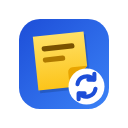
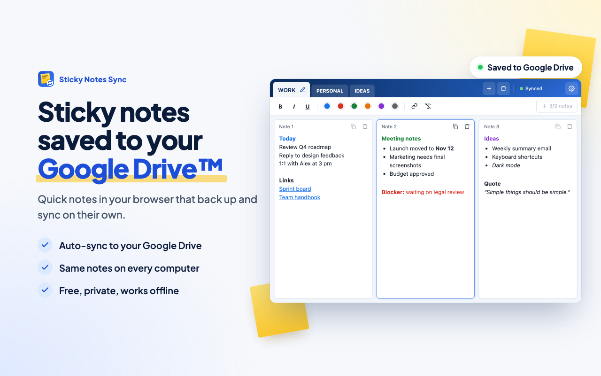

<p align="center">
  
</p>

<h1 align="center">Sticky Notes Sync</h1>

<p align="center">
  Sticky notes and a notepad in your browser, saved automatically to <b>your own</b> Google Drive.<br>
  No servers, no tracking, open source.
</p>

<p align="center">
  <a href="https://hduy-dev.github.io/sticky-notes-sync/">Website</a> ·
  <a href="https://hduy-dev.github.io/sticky-notes-sync/privacy.html">Privacy Policy</a> ·
  <a href="LICENSE">MIT License</a>
</p>



## Features

- **Folders as tabs**, each holding up to three side-by-side notes that fill the popup and scroll on their own.
- **Rich text**: bold, italic, underline, six text colors and clickable links. Pasting from web pages keeps simple formatting and strips everything else.
- **Instant and offline**: every keystroke is saved locally; nothing to press.
- **Sync with Google**: sign in once and your notes go to a "Sticky Notes Sync" spreadsheet in your Drive, so you see the same notes on every computer.
- **Private by design**: the extension can only touch files it created (`drive.file` scope), and the developer never receives your data.
- **Works in Chromium browsers**: Chrome, Edge, Brave, Cốc Cốc and others.

## Install

**From the Chrome Web Store:** _coming soon_ (under review).

**From source:**

1. Download or clone this repository.
2. Open `chrome://extensions` and turn on **Developer mode**.
3. Click **Load unpacked** and pick the repository folder.

Notes work right away. To sync, click the gear icon in the popup, then **Sign in with Google**. On Google's screen, make sure the Google Drive box is ticked.

> Building your own copy? Google sign-in only works with an OAuth client that lists your extension's ID. See [Using your own Google OAuth client](#using-your-own-google-oauth-client).

## Privacy

Your notes live in two places only: your browser, and (if you sign in) a spreadsheet in your own Google Drive. There is no backend, analytics or advertising. The extension asks for `openid`, `email` and `https://www.googleapis.com/auth/drive.file`, so it can see only the spreadsheet it created and none of your other files. Full details: [PRIVACY.md](PRIVACY.md).

## How it works

```
popup (UI) ──messages──▶ background service worker ──▶ chrome.storage.local
                                 │
                                 └── sync ──▶ Google Drive v3 + Sheets v4 REST APIs
                                              (spreadsheet in the user's Drive)
```

- **One writer.** The popup never writes note data itself. It sends changes to the background worker, which applies them one at a time, so concurrent writes can't clobber each other.
- **Last write wins, per record.** Every folder and note carries `updatedAt`. A sync round reads the spreadsheet, merges it into local data, keeping the newer copy of each record, then writes only the rows this device changed. Rows are updated in place or appended, never rewritten or deleted, so two computers syncing at the same moment don't overwrite each other.
- **Deletes are tombstones.** Deleted folders and notes stay as `deleted: true` rows so other devices learn about them.
- **Resilient.** Sync runs about 2 seconds after an edit and retries every minute while anything is unsynced. Offline edits, expired sessions, a missing Drive permission and a deleted spreadsheet are all handled without losing notes.
- **Sign-in without secrets.** `chrome.identity.launchWebAuthFlow` with Google's token flow works in any Chromium browser and needs no client secret. Tokens last about an hour and are renewed silently.

The spreadsheet has two tabs you can read directly:

| Tab | Columns |
| --- | --- |
| `Folders` | `id`, `name`, `order`, `updatedAt`, `deleted`, `updated` |
| `Notes` | `id`, `folderId`, `folder`, `order`, `text`, `html`, `updatedAt`, `deleted`, `updated` |

## Project structure

```
manifest.json            Manifest V3
src/
  background.js          service worker: message handling, sync scheduling
  config.js              OAuth client ID and spreadsheet constants
  lib/
    model.js             data model and mutations (pure)
    merge.js             last-write-wins merge (pure)
    sanitize.js          allowlist HTML sanitizer, no DOM needed (pure)
    sheet-rows.js        rows <-> records, which rows to write (pure)
    google-auth.js       sign-in, silent token renewal, Drive-permission check
    sheets-store.js      Drive/Sheets REST calls
    sync.js              sync rounds, sign-in/out, account switching
  popup/                 popup UI and rich-text editor
tests/                   node:test suites for everything in src/lib
docs/                    website, privacy policy, publishing and compliance notes
scripts/build.sh         builds the Chrome Web Store zip
```

Plain JavaScript ES modules, no framework, no build step and no npm dependencies.

## Development

Requirements: Node.js 20 or newer (for tests only).

```sh
npm test        # unit tests (node:test)
npm run build   # dist/sticky-notes-sync-<version>.zip for the Chrome Web Store
```

After changing files, click **↻** on the extension in `chrome://extensions`. The popup picks up changes when reopened, but the background worker only reloads this way.

### Using your own Google OAuth client

The client ID in `src/config.js` belongs to this project and only accepts this extension's ID. To run sign-in from a fork:

1. Give your unpacked build a fixed ID: generate a key and put its public part in `manifest.json` as `"key"` (steps in [docs/PUBLISHING.md](docs/PUBLISHING.md#1-give-the-dev-build-a-stable-extension-id)).
2. In Google Cloud, create a project, enable the **Google Drive API** and **Google Sheets API**, and configure the OAuth consent screen with the `openid`, `email` and `drive.file` scopes.
3. Create an OAuth client of type **Web application** with the redirect URI `https://<your-extension-id>.chromiumapp.org/`.
4. Put your client ID in `src/config.js`.

[docs/PUBLISHING.md](docs/PUBLISHING.md) walks through every step, including publishing to the Chrome Web Store. [docs/COMPLIANCE.md](docs/COMPLIANCE.md) lists the permission justifications and policy checks.

## Contributing

Issues and pull requests are welcome. Please:

- keep the extension dependency-free and the `src/lib` modules pure where they are now;
- add or update tests for behaviour changes (`npm test` must pass);
- don't widen the OAuth scopes. `drive.file` is a deliberate privacy choice.

## License

[MIT](LICENSE) © 2026 Dylan

Sticky Notes Sync is not affiliated with Google. Google, Google Drive and Google Sheets are trademarks of Google LLC.
